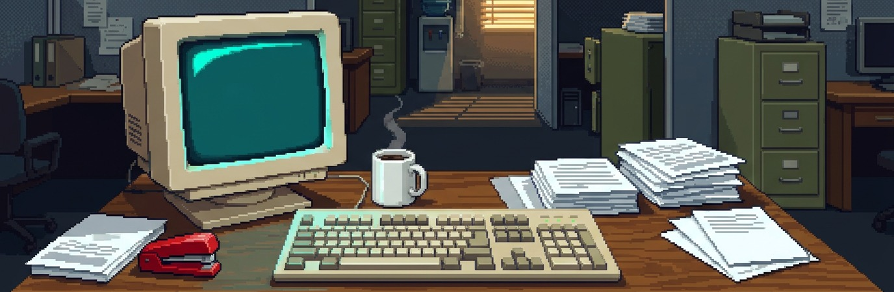

# Flip the Table (╯°□°)╯︵ ┻━┻

[**Sick of work? Flip the table!**](https://flipthetable.alexkennedy.dev)

[](https://www.rust-lang.org/)
[](https://bevyengine.org/)
[](https://github.com/Jondolf/avian)
[](https://nextjs.org/)
[](https://pages.cloudflare.com/)
[](LICENSE)

> [!WARNING]
> **Slop Alert:** I haven't even read this code.

A 3D retro pixel-art table-flipping game in the browser, built with Rust (Bevy + Avian3D) compiled to WebAssembly and wrapped in a Next.js frontend. Built by Gemini for funsies.

## Getting Started

### Prerequisites

- **Rust** (2024 edition) with the `wasm32-unknown-unknown` target
- [`wasm-pack`](https://rustwasm.github.io/wasm-pack/)
- **Node.js** 20+ and `npm`
- `gzip`

### Local Development

```bash
cd web
npm install
npm run dev
```

This builds `crates/game` in dev mode, compresses `flipthetable_game_bg.wasm` to `.wasm.gz`, and starts the Next.js dev server.

### Production Build

```bash
cd web
npm run build
```

## Deployment

Configured for **Cloudflare Pages** via [`web/wrangler.jsonc`](web/wrangler.jsonc):

```bash
cd web
npm run deploy
```

The login page and scoring is managed by Firebase.

## License

[MIT](LICENSE)
